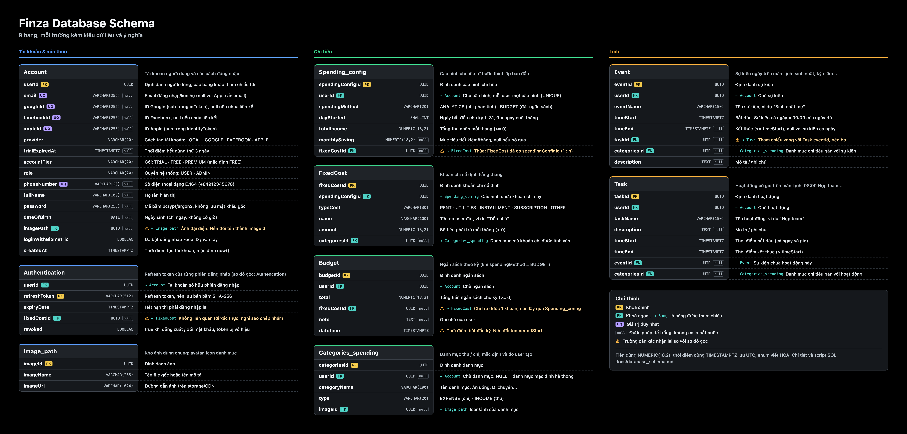
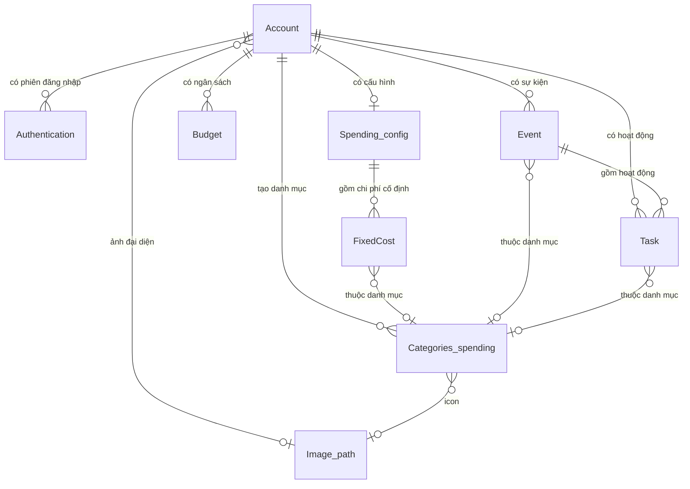

# Finza: Database Schema

Tài liệu mô tả 9 bảng trong sơ đồ dữ liệu của Finza: kiểu dữ liệu, ràng buộc và ý nghĩa của từng trường, kèm script SQL để tạo bảng.



## Quy ước chung

| Quy ước | Áp dụng |
|---|---|
| Hệ quản trị | Script viết cho **PostgreSQL**. Với MySQL: `UUID` → `CHAR(36)`, `TIMESTAMPTZ` → `DATETIME`, `BOOLEAN` → `TINYINT(1)`. |
| Khoá chính | `UUID`, sinh bằng `gen_random_uuid()`. |
| Tên cột | Giữ nguyên camelCase như sơ đồ. Trong PostgreSQL phải đặt trong dấu nháy kép (`"userId"`). |
| Tiền | `NUMERIC(18,2)`. Không dùng `FLOAT`/`DOUBLE`, vì số thực dấu phẩy động làm sai số khi cộng dồn tiền. |
| Thời điểm | `TIMESTAMPTZ`, lưu theo UTC. App tự đổi sang giờ địa phương khi hiển thị. |
| Enum | `VARCHAR` + `CHECK`, giá trị viết HOA (khớp với app, ví dụ app đang gửi `provider: 'GOOGLE'`). |
| Tên bảng | Sơ đồ ghi `Authencation`. Tài liệu này dùng tên đúng chính tả là **`Authentication`**. |

Ký hiệu trong bảng: **PK** khoá chính, **FK** khoá ngoại, **UQ** duy nhất, **NN** không được null.

---

## 1. Authentication

Lưu refresh token của từng phiên đăng nhập. Mỗi thiết bị đăng nhập tạo một dòng, nên một user có thể có nhiều dòng.

| Trường | Kiểu | Ràng buộc | Ý nghĩa |
|---|---|---|---|
| `userId` | `UUID` | FK → `Account.userId`, NN | Tài khoản sở hữu token. |
| `refreshToken` | `VARCHAR(512)` | PK | Refresh token dùng để cấp lại access token. Nên lưu **bản băm** (SHA-256) thay vì token gốc, để lộ DB không lộ được phiên đăng nhập. |
| `expiryDate` | `TIMESTAMPTZ` | NN | Thời điểm token hết hạn. Quá thời điểm này user phải đăng nhập lại. |
| `fixedCostId` | `UUID` | FK → `FixedCost.fixedCostId`, null | ⚠ Có trong sơ đồ nhưng không liên quan tới xác thực. Nhiều khả năng là sao chép nhầm (xem mục [Điểm cần xác nhận](#điểm-cần-xác-nhận)). |
| `revoked` | `BOOLEAN` | NN, mặc định `false` | `true` khi token bị thu hồi: user đăng xuất, đổi mật khẩu hoặc bị khoá. Token đã thu hồi không dùng được dù chưa hết hạn. |

## 2. Account

Thông tin tài khoản người dùng, bao gồm các cách đăng nhập (email, Google, Facebook, Apple).

| Trường | Kiểu | Ràng buộc | Ý nghĩa |
|---|---|---|---|
| `userId` | `UUID` | PK | Định danh người dùng, các bảng khác tham chiếu tới trường này. |
| `email` | `VARCHAR(255)` | UQ, null | Email đăng nhập/liên hệ. Có thể null với tài khoản Apple ẩn email. |
| `googleId` | `VARCHAR(255)` | UQ, null | ID tài khoản Google (`sub` trong idToken). Null nếu chưa liên kết Google. |
| `facebookId` | `VARCHAR(255)` | UQ, null | ID tài khoản Facebook. Null nếu chưa liên kết. |
| `appleId` | `VARCHAR(255)` | UQ, null | ID tài khoản Apple (`sub` trong identityToken). Null nếu chưa liên kết. |
| `provider` | `VARCHAR(20)` | NN | Cách tạo tài khoản: `LOCAL` (email + mật khẩu), `GOOGLE`, `FACEBOOK`, `APPLE`. |
| `trialExpiredAt` | `TIMESTAMPTZ` | null | Thời điểm hết dùng thử ("Try it for 3 days"). Null nếu không phải tài khoản dùng thử. |
| `accountTier` | `VARCHAR(20)` | NN, mặc định `FREE` | Gói tài khoản: `TRIAL`, `FREE`, `PREMIUM`. Quyết định tính năng được dùng. |
| `role` | `VARCHAR(20)` | NN, mặc định `USER` | Quyền hệ thống: `USER` hoặc `ADMIN`. |
| `phoneNumber` | `VARCHAR(20)` | UQ, null | Số điện thoại, lưu dạng E.164 (`+84912345678`). |
| `fullName` | `VARCHAR(100)` | null | Họ tên hiển thị. |
| `password` | `VARCHAR(255)` | null | **Mã băm** mật khẩu (bcrypt/argon2), không bao giờ lưu mật khẩu gốc. Null với tài khoản chỉ đăng nhập mạng xã hội. |
| `dateOfBirth` | `DATE` | null | Ngày sinh (chỉ ngày, không có giờ). |
| `imagePath` | `UUID` | FK → `Image_path.imageId`, null | Ảnh đại diện. Sơ đồ đặt tên `imagePath`, nhưng nên trỏ tới `Image_path.imageId` thay vì lưu URL trực tiếp. |
| `loginWithBiometric` | `BOOLEAN` | NN, mặc định `false` | User đã bật đăng nhập bằng Face ID / vân tay. |
| `createdAt` | `TIMESTAMPTZ` | NN, mặc định `now()` | Thời điểm tạo tài khoản. |

## 3. Spending_config

Cấu hình quản lý chi tiêu, được tạo ở bước thiết lập ban đầu (onboarding setup). Mỗi user có một cấu hình.

| Trường | Kiểu | Ràng buộc | Ý nghĩa |
|---|---|---|---|
| `spendingConfigId` | `UUID` | PK | Định danh cấu hình. |
| `userId` | `UUID` | FK → `Account.userId`, UQ, NN | Chủ cấu hình. UQ để mỗi user chỉ có một cấu hình. |
| `spendingMethod` | `VARCHAR(20)` | NN | Cách quản lý chi tiêu: `ANALYTICS` (chỉ ghi nhận, phân tích) hoặc `BUDGET` (đặt ngân sách theo kỳ). Khớp với `ExpenseManagementMode` trong app. |
| `dayStarted` | `SMALLINT` | NN, `0..31` | Ngày bắt đầu chu kỳ chi tiêu mỗi tháng. `1..31` là ngày cụ thể, `0` là **ngày cuối tháng** (khớp với `CycleDay` trong app; ngày 31 tự lùi về 30/29/28 với tháng ngắn hơn). |
| `totalIncome` | `NUMERIC(18,2)` | NN, `>= 0` | Tổng thu nhập mỗi tháng. |
| `monthlySaving` | `NUMERIC(18,2)` | null, `>= 0` | Mục tiêu tiết kiệm mỗi tháng. Null nếu user bỏ qua bước này. |
| `fixedCostId` | `UUID` | FK → `FixedCost.fixedCostId`, null | ⚠ Một cấu hình có **nhiều** chi phí cố định, nên một cột FK ở đây chỉ trỏ được tới một khoản. Bảng `FixedCost` đã có `spendingConfigId` cho chiều ngược lại. |

## 4. FixedCost

Các khoản chi cố định hằng tháng: tiền nhà, điện nước, trả góp...

| Trường | Kiểu | Ràng buộc | Ý nghĩa |
|---|---|---|---|
| `fixedCostId` | `UUID` | PK | Định danh khoản chi. |
| `spendingConfigId` | `UUID` | FK → `Spending_config.spendingConfigId`, NN | Cấu hình chứa khoản chi này (quan hệ 1 cấu hình : n khoản). |
| `typeCost` | `VARCHAR(30)` | NN | Loại chi phí cố định, ví dụ `RENT`, `UTILITIES`, `INSTALLMENT`, `SUBSCRIPTION`, `OTHER`. Dùng để nhóm và gợi ý icon. |
| `name` | `VARCHAR(100)` | NN | Tên do user đặt, ví dụ "Tiền nhà". |
| `amount` | `NUMERIC(18,2)` | NN, `> 0` | Số tiền phải trả mỗi tháng. |
| `categoriesId` | `UUID` | FK → `Categories_spending.categoriesId`, null | Danh mục chi tiêu mà khoản này được tính vào. |

## 5. Budget

Ngân sách của user. Chỉ dùng khi `Spending_config.spendingMethod = 'BUDGET'`.

| Trường | Kiểu | Ràng buộc | Ý nghĩa |
|---|---|---|---|
| `budgetId` | `UUID` | PK | Định danh ngân sách. |
| `userId` | `UUID` | FK → `Account.userId`, NN | Chủ ngân sách. |
| `total` | `NUMERIC(18,2)` | NN, `>= 0` | Tổng số tiền ngân sách cho kỳ. |
| `fixedCostId` | `UUID` | FK → `FixedCost.fixedCostId`, null | ⚠ Khoản chi cố định gắn với ngân sách. Nếu ngân sách cần trừ **tất cả** chi phí cố định thì không cần cột này (xem mục cần xác nhận). |
| `note` | `TEXT` | null | Ghi chú của user. |
| `datetime` | `TIMESTAMPTZ` | NN | Mốc thời gian của ngân sách: thời điểm bắt đầu kỳ ngân sách áp dụng. Tên `datetime` trùng từ khoá ở một số DB; nên đổi thành `periodStart`. |

## 6. Categories_spending

Danh mục chi tiêu (Ăn uống, Di chuyển, Mua sắm...), gồm cả danh mục mặc định và danh mục user tự tạo.

| Trường | Kiểu | Ràng buộc | Ý nghĩa |
|---|---|---|---|
| `categoriesId` | `UUID` | PK | Định danh danh mục. |
| `userId` | `UUID` | FK → `Account.userId`, null | Chủ danh mục. **Null = danh mục mặc định của hệ thống**, dùng chung cho mọi user. |
| `categoryName` | `VARCHAR(100)` | NN | Tên danh mục. |
| `type` | `VARCHAR(20)` | NN | Loại danh mục: `EXPENSE` (chi) hoặc `INCOME` (thu). |
| `imageId` | `UUID` | FK → `Image_path.imageId`, null | Icon/ảnh của danh mục. |

## 7. Image_path

Kho ảnh dùng chung: ảnh đại diện, icon danh mục...

| Trường | Kiểu | Ràng buộc | Ý nghĩa |
|---|---|---|---|
| `imageId` | `UUID` | PK | Định danh ảnh. |
| `imageName` | `VARCHAR(255)` | NN | Tên file gốc hoặc tên mô tả, dùng để quản lý. |
| `imageUrl` | `VARCHAR(1024)` | NN | Đường dẫn ảnh trên storage/CDN. |

## 8. Event

Sự kiện gắn với một ngày, tương ứng phần **"Sự kiện ngày"** trên màn Lịch (sinh nhật, kỷ niệm, ngày đặc biệt).

| Trường | Kiểu | Ràng buộc | Ý nghĩa |
|---|---|---|---|
| `eventId` | `UUID` | PK | Định danh sự kiện. |
| `userId` | `UUID` | FK → `Account.userId`, NN | Chủ sự kiện. |
| `eventName` | `VARCHAR(150)` | NN | Tên sự kiện, ví dụ "Sinh nhật mẹ". |
| `timeStart` | `TIMESTAMPTZ` | NN | Thời điểm bắt đầu. Với sự kiện cả ngày thì là 00:00 của ngày đó. |
| `timeEnd` | `TIMESTAMPTZ` | null, `>= timeStart` | Thời điểm kết thúc. Null với sự kiện cả ngày. |
| `taskId` | `UUID` | FK → `Task.taskId`, null | ⚠ Task liên quan. `Task` cũng có `eventId` trỏ ngược lại, nên hai bảng đang tham chiếu vòng. |
| `categoriesId` | `UUID` | FK → `Categories_spending.categoriesId`, null | Danh mục chi tiêu gắn với sự kiện (ví dụ sinh nhật thì vào "Quà tặng"), để thống kê chi tiêu theo sự kiện. |
| `description` | `TEXT` | null | Mô tả/ghi chú. |

## 9. Task

Hoạt động có giờ cụ thể trong ngày, tương ứng phần **"Lịch trong ngày"** trên màn Lịch (08:00 Làm việc, 12:00 Ăn trưa...).

| Trường | Kiểu | Ràng buộc | Ý nghĩa |
|---|---|---|---|
| `taskId` | `UUID` | PK | Định danh hoạt động. |
| `userId` | `UUID` | FK → `Account.userId`, NN | Chủ hoạt động. |
| `taskName` | `VARCHAR(150)` | NN | Tên hoạt động, ví dụ "Họp team". |
| `description` | `TEXT` | null | Mô tả/ghi chú. |
| `timeStart` | `TIMESTAMPTZ` | NN | Thời điểm bắt đầu (gồm cả ngày và giờ). |
| `timeEnd` | `TIMESTAMPTZ` | NN, `> timeStart` | Thời điểm kết thúc. |
| `eventId` | `UUID` | FK → `Event.eventId`, null | Sự kiện mà hoạt động này thuộc về, ví dụ "Mua bánh" thuộc "Sinh nhật mẹ". |
| `categoriesId` | `UUID` | FK → `Categories_spending.categoriesId`, null | Danh mục chi tiêu gắn với hoạt động. |

---

## Quan hệ giữa các bảng



Sơ đồ trên thể hiện quan hệ theo đề xuất ở mục dưới (bỏ các FK ngược chiều).

## Điểm cần xác nhận

Các điểm sau trong sơ đồ gốc có vẻ mâu thuẫn hoặc thiếu. Script SQL bên dưới **vẫn giữ đúng sơ đồ gốc**; các cột bị nghi ngờ được đánh dấu `-- ⚠` để bạn quyết định giữ hay bỏ.

1. **`Authentication.fixedCostId`**: bảng xác thực không liên quan tới chi phí cố định, nhiều khả năng là sao chép nhầm. Đề xuất: bỏ.
2. **`Spending_config.fixedCostId` và `FixedCost.spendingConfigId`**: quan hệ là 1 cấu hình : n chi phí, nên chỉ cần `FixedCost.spendingConfigId`. Đề xuất: bỏ `Spending_config.fixedCostId`.
3. **`Event.taskId` và `Task.eventId`**: tham chiếu vòng. Nếu một sự kiện có nhiều hoạt động thì chỉ cần `Task.eventId`. Đề xuất: bỏ `Event.taskId`.
4. **`Budget.fixedCostId`**: một cột chỉ trỏ được tới một khoản chi cố định. Nếu ngân sách cần trừ toàn bộ chi phí cố định, lấy qua `Spending_config` → `FixedCost` và bỏ cột này.
5. **`Account.imagePath`**: nên đổi tên thành `imageId` cho khớp với khoá của `Image_path`.
6. **`Budget.datetime`**: tên trùng kiểu dữ liệu/từ khoá ở một số DB. Đề xuất đổi thành `periodStart`.
7. **`Event` còn thiếu các trường mà màn Lịch đang dùng** (xem `DayEventModel` trong `lib/src/feature/schedule/models/day_event_model.dart`). Đề xuất thêm:

   | Trường | Kiểu | Ý nghĩa |
   |---|---|---|
   | `type` | `VARCHAR(20)` | `BIRTHDAY`, `ANNIVERSARY`, `SPECIAL`, `CUSTOM`. |
   | `color` | `INTEGER` | Màu user chọn, lưu dạng ARGB (ví dụ `0xFFD9578B`). |
   | `icon` | `VARCHAR(30)` | Key icon user chọn (`cake`, `heart`, `gift`...). Lưu key thay vì mã icon để đổi bộ icon không làm hỏng dữ liệu cũ. |
   | `isAllDay` | `BOOLEAN` | Sự kiện cả ngày hay có khung giờ. |
   | `repeatsYearly` | `BOOLEAN` | Lặp lại hằng năm (sinh nhật, kỷ niệm). |

   Ngày lễ chung (Tết, Trung Thu...) hiện do app tự cung cấp. Nếu muốn backend quản lý thì cần thêm bảng `System_event` riêng, không có `userId`.
8. **`Task` chưa có trạng thái hoàn thành**: màn Lịch cho phép đánh dấu hoàn thành và đặt lời nhắc. Đề xuất thêm `isCompleted BOOLEAN`, `reminderMinutes SMALLINT` (số phút nhắc trước, null = không nhắc) và `repeat VARCHAR(20)` (`NONE`, `DAILY`, `WEEKLY`, `MONTHLY`, `YEARLY`).
9. Các bảng chưa có `createdAt`/`updatedAt` (trừ `Account`). Nên thêm cho mọi bảng để đồng bộ dữ liệu và debug.

---

## Script SQL (PostgreSQL)

Thứ tự tạo bảng đã tính đến khoá ngoại. Các FK vòng (`Authentication`/`Spending_config`/`Budget` → `FixedCost`, `Event` ↔ `Task`) được thêm sau cùng bằng `ALTER TABLE`.

```sql
CREATE EXTENSION IF NOT EXISTS pgcrypto; -- gen_random_uuid()

-- 7. Image_path
CREATE TABLE "Image_path" (
    "imageId"    UUID PRIMARY KEY DEFAULT gen_random_uuid(),
    "imageName"  VARCHAR(255)  NOT NULL,
    "imageUrl"   VARCHAR(1024) NOT NULL
);

-- 2. Account
CREATE TABLE "Account" (
    "userId"             UUID PRIMARY KEY DEFAULT gen_random_uuid(),
    "email"              VARCHAR(255) UNIQUE,
    "googleId"           VARCHAR(255) UNIQUE,
    "facebookId"         VARCHAR(255) UNIQUE,
    "appleId"            VARCHAR(255) UNIQUE,
    "provider"           VARCHAR(20)  NOT NULL
                         CHECK ("provider" IN ('LOCAL', 'GOOGLE', 'FACEBOOK', 'APPLE')),
    "trialExpiredAt"     TIMESTAMPTZ,
    "accountTier"        VARCHAR(20)  NOT NULL DEFAULT 'FREE'
                         CHECK ("accountTier" IN ('TRIAL', 'FREE', 'PREMIUM')),
    "role"               VARCHAR(20)  NOT NULL DEFAULT 'USER'
                         CHECK ("role" IN ('USER', 'ADMIN')),
    "phoneNumber"        VARCHAR(20)  UNIQUE,
    "fullName"           VARCHAR(100),
    "password"           VARCHAR(255),          -- bcrypt/argon2 hash
    "dateOfBirth"        DATE,
    "imagePath"          UUID REFERENCES "Image_path" ("imageId") ON DELETE SET NULL,
    "loginWithBiometric" BOOLEAN      NOT NULL DEFAULT FALSE,
    "createdAt"          TIMESTAMPTZ  NOT NULL DEFAULT now()
);

-- 1. Authentication (sơ đồ ghi "Authencation")
CREATE TABLE "Authentication" (
    "refreshToken" VARCHAR(512) PRIMARY KEY,    -- nên lưu SHA-256 của token
    "userId"       UUID        NOT NULL REFERENCES "Account" ("userId") ON DELETE CASCADE,
    "expiryDate"   TIMESTAMPTZ NOT NULL,
    "fixedCostId"  UUID,                        -- ⚠ nghi sao chép nhầm, xem mục 1
    "revoked"      BOOLEAN     NOT NULL DEFAULT FALSE
);
CREATE INDEX "idx_authentication_user" ON "Authentication" ("userId");

-- 3. Spending_config
CREATE TABLE "Spending_config" (
    "spendingConfigId" UUID PRIMARY KEY DEFAULT gen_random_uuid(),
    "userId"           UUID NOT NULL UNIQUE REFERENCES "Account" ("userId") ON DELETE CASCADE,
    "spendingMethod"   VARCHAR(20)   NOT NULL
                       CHECK ("spendingMethod" IN ('ANALYTICS', 'BUDGET')),
    "dayStarted"       SMALLINT      NOT NULL CHECK ("dayStarted" BETWEEN 0 AND 31), -- 0 = ngày cuối tháng
    "totalIncome"      NUMERIC(18,2) NOT NULL CHECK ("totalIncome" >= 0),
    "monthlySaving"    NUMERIC(18,2) CHECK ("monthlySaving" >= 0),
    "fixedCostId"      UUID                         -- ⚠ thừa, xem mục 2
);

-- 6. Categories_spending
CREATE TABLE "Categories_spending" (
    "categoriesId" UUID PRIMARY KEY DEFAULT gen_random_uuid(),
    "userId"       UUID REFERENCES "Account" ("userId") ON DELETE CASCADE, -- NULL = danh mục hệ thống
    "categoryName" VARCHAR(100) NOT NULL,
    "type"         VARCHAR(20)  NOT NULL CHECK ("type" IN ('EXPENSE', 'INCOME')),
    "imageId"      UUID REFERENCES "Image_path" ("imageId") ON DELETE SET NULL
);
CREATE INDEX "idx_categories_user" ON "Categories_spending" ("userId");

-- 4. FixedCost
CREATE TABLE "FixedCost" (
    "fixedCostId"      UUID PRIMARY KEY DEFAULT gen_random_uuid(),
    "spendingConfigId" UUID NOT NULL REFERENCES "Spending_config" ("spendingConfigId") ON DELETE CASCADE,
    "typeCost"         VARCHAR(30)   NOT NULL,
    "name"             VARCHAR(100)  NOT NULL,
    "amount"           NUMERIC(18,2) NOT NULL CHECK ("amount" > 0),
    "categoriesId"     UUID REFERENCES "Categories_spending" ("categoriesId") ON DELETE SET NULL
);
CREATE INDEX "idx_fixedcost_config" ON "FixedCost" ("spendingConfigId");

-- 5. Budget
CREATE TABLE "Budget" (
    "budgetId"    UUID PRIMARY KEY DEFAULT gen_random_uuid(),
    "userId"      UUID NOT NULL REFERENCES "Account" ("userId") ON DELETE CASCADE,
    "total"       NUMERIC(18,2) NOT NULL CHECK ("total" >= 0),
    "fixedCostId" UUID,                             -- ⚠ xem mục 4
    "note"        TEXT,
    "datetime"    TIMESTAMPTZ   NOT NULL            -- đề xuất đổi tên "periodStart"
);
CREATE INDEX "idx_budget_user_time" ON "Budget" ("userId", "datetime");

-- 8. Event
CREATE TABLE "Event" (
    "eventId"      UUID PRIMARY KEY DEFAULT gen_random_uuid(),
    "userId"       UUID NOT NULL REFERENCES "Account" ("userId") ON DELETE CASCADE,
    "eventName"    VARCHAR(150) NOT NULL,
    "timeStart"    TIMESTAMPTZ  NOT NULL,
    "timeEnd"      TIMESTAMPTZ,
    "taskId"       UUID,                            -- ⚠ tham chiếu vòng, xem mục 3
    "categoriesId" UUID REFERENCES "Categories_spending" ("categoriesId") ON DELETE SET NULL,
    "description"  TEXT,
    CHECK ("timeEnd" IS NULL OR "timeEnd" >= "timeStart")
);
CREATE INDEX "idx_event_user_time" ON "Event" ("userId", "timeStart");

-- 9. Task
CREATE TABLE "Task" (
    "taskId"       UUID PRIMARY KEY DEFAULT gen_random_uuid(),
    "userId"       UUID NOT NULL REFERENCES "Account" ("userId") ON DELETE CASCADE,
    "taskName"     VARCHAR(150) NOT NULL,
    "description"  TEXT,
    "timeStart"    TIMESTAMPTZ  NOT NULL,
    "timeEnd"      TIMESTAMPTZ  NOT NULL,
    "eventId"      UUID REFERENCES "Event" ("eventId") ON DELETE SET NULL,
    "categoriesId" UUID REFERENCES "Categories_spending" ("categoriesId") ON DELETE SET NULL,
    CHECK ("timeEnd" > "timeStart")
);
CREATE INDEX "idx_task_user_time" ON "Task" ("userId", "timeStart");

-- Khoá ngoại vòng / nghi vấn: thêm sau khi đủ bảng.
-- Bỏ dòng tương ứng nếu bạn quyết định xoá cột theo mục "Điểm cần xác nhận".
ALTER TABLE "Authentication"  ADD FOREIGN KEY ("fixedCostId") REFERENCES "FixedCost" ("fixedCostId") ON DELETE SET NULL;
ALTER TABLE "Spending_config" ADD FOREIGN KEY ("fixedCostId") REFERENCES "FixedCost" ("fixedCostId") ON DELETE SET NULL;
ALTER TABLE "Budget"          ADD FOREIGN KEY ("fixedCostId") REFERENCES "FixedCost" ("fixedCostId") ON DELETE SET NULL;
ALTER TABLE "Event"           ADD FOREIGN KEY ("taskId")      REFERENCES "Task" ("taskId")           ON DELETE SET NULL;
```
